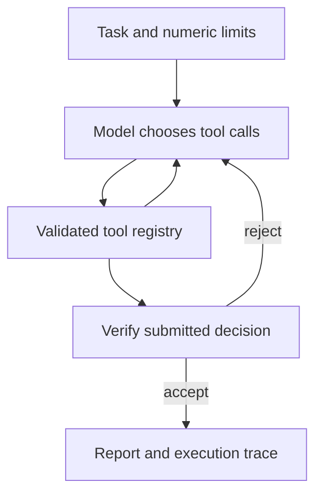

# Agentic AI Lab

**A tool-using benchmark analyst with bounded execution and verified decisions.**
Application code by **Hamid Gadirov**.

The agent inspects local inference benchmark reports, compares runs under explicit
latency and error limits, and recommends the highest-throughput eligible run.
A chat model chooses its tool calls. Python handles measurement arithmetic,
workload matching, evidence identifiers, and final decision verification.

This is a small, inspectable project for learning agent orchestration and
demonstrating engineering practice. It includes a real chat-completions client,
a clearly labelled scripted offline demo, synthetic fixtures, tests, and CI.

## Try it without a GPU

```bash
python3 -m venv .venv
source .venv/bin/activate
python -m pip install -e .
python -m agent_lab demo
python -m agent_lab evaluate
```

Open `outputs/demo/report.md` and `outputs/demo/trace.jsonl`. The demo selects
`fast`: the absolute highest-throughput run violates the latency limits, and
another fast run violates the error-rate limit. The strict case returns no
eligible run; the unseen-workload case returns no matching runs.

**All bundled measurements and model labels are fabricated synthetic fixtures.**
The offline provider follows a deterministic tool-use script. Its evaluation
checks the workflow, not the intelligence of a language model. Existing output
folders are preserved; choose a new `--output outputs/another-run` when rerunning.

## Use an actual tool-calling model

Run a compatible server on suitable hardware. For example, in your separate
vLLM environment:

```bash
vllm serve openai/gpt-oss-20b \
  --served-model-name local-agent \
  --host 127.0.0.1 --port 8000 \
  --max-model-len 16384 \
  --enable-auto-tool-choice --tool-call-parser openai
```

The `openai` parser is documented for gpt-oss. Other models need their own
parser/template configuration; do not infer compatibility from the HTTP API
alone. Check the current [vLLM tool-calling guide](https://docs.vllm.ai/en/latest/features/tool_calling/).
No model weights or inference framework are installed by this project's base dependencies.

Then, from the application environment:

```bash
python -m agent_lab run --model local-agent --output outputs/live
```

The default live run uses the same synthetic workspace so its tool choices are
easy to inspect. Live model/GPU acceptance has not been run for this release.
The HTTP integration is tested against a local scripted server.

Optional environment variables are `AGENT_BASE_URL`, `AGENT_MODEL`, and
`AGENT_API_KEY`. The base URL defaults to localhost. The API key is read from the
environment and is not included in traces. `.env.example` is a reference; export
the variables yourself or use your preferred environment manager. Selecting a
remote endpoint sends task and retrieved evidence to that endpoint.

## The agent loop



| Tool | Purpose |
| --- | --- |
| `list_runs` | Discover runs matching all workload and accelerator fields |
| `read_run` | Inspect a normalized record and its source digest |
| `search_notes` | Retrieve bounded excerpts from local reference notes |
| `compare_runs` | Apply limits and rank the complete matching candidate set |
| `submit_decision` | Finish only with a known comparison and its verified winner |

The model can inspect evidence in different orders, recover from invalid tool
arguments, and decide when to compare and submit. It cannot create new tools,
execute a shell, choose arbitrary filesystem paths, or turn free text into a
verified final answer. The report's numbers and recommendation are rendered from
the checked comparison rather than extracted from generated prose.

The selection policy is explicit: maximize reported output tokens/second after
meeting both P95 latency limits and the request error-rate limit. Ties use lower
P95 time to first token, then run ID. This is a performance policy; model quality,
cost, and statistical significance need additional measurements.

## Bring your own reports

Use `workspace/runs/*.json` for normalized records and `workspace/notes/*.md` for
optional reference text. Copy a task from `agent_lab/fixtures/tasks/` and change
the workload metadata and numeric limits. See [data contracts](docs/data.md).

```bash
python -m agent_lab import-vllm outputs/vllm-result.json \
  --metadata examples/run-metadata.json \
  --output workspace/runs/candidate-a.json

python -m agent_lab run \
  --workspace workspace --task examples/task.json \
  --model local-agent --output outputs/my-analysis
```

The importer expects an explicit flat report format and rejects missing failure
counts or percentile metrics. Edit the illustrative metadata/task files to match
your actual experiment. No automatic log-format guessing or silent missing-value
defaults are used. Workspaces and generated outputs are ignored by Git.

## Bounds and observability

Default limits are eight model turns, 24 tool calls, three tool errors, 120 seconds
overall, 30 seconds per model request, and 96 KB of serialized conversation.
The workspace supports at most 16 runs and 16 notes, each at most 64 KiB. The
HTTP client bounds response size and retries transient HTTP failures at most
once within the same request deadline. See [design](docs/design.md).

`decision.json` contains the checked comparison and source digests; `report.md`
contains the human-readable result; `trace.jsonl` records execution events and
tool observations. The trace does not store model reasoning fields. It can still
contain task data and benchmark evidence: keep real-data traces local.

## Tests and files

```bash
python -m unittest discover -s tests -v
```

Tests cover evidence isolation, incomplete comparisons, forged citations, wrong
winners, invalid arguments, error recovery, execution budgets, trace behavior,
benchmark import, and a complete multi-turn HTTP exchange.

| File | Responsibility |
| --- | --- |
| `agent_lab/engine.py` | Bounded loop, tool dispatch, errors, trace events |
| `agent_lab/providers.py` | Live HTTP client and explicitly scripted demo |
| `agent_lab/tools.py` | Evidence access, comparison policy, decision verifier |
| `agent_lab/contracts.py` | JSON schemas, strict parsing, canonical digests |
| `agent_lab/reporting.py` | Render checked results |
| `agent_lab/importing.py` | Explicit vLLM report normalization |
| `agent_lab/cli.py` | CLI and fixture evaluation |

[Validation scope](VALIDATION.md) · [Data format](docs/data.md) ·
[Design and limitations](docs/design.md) · [Primary references](docs/sources.md)

Original application code is MIT licensed. The project depends on public
interfaces and contains no employer code, model weights, real benchmark records,
or copied repository history. Model and framework authors retain their own
authorship and license terms.
